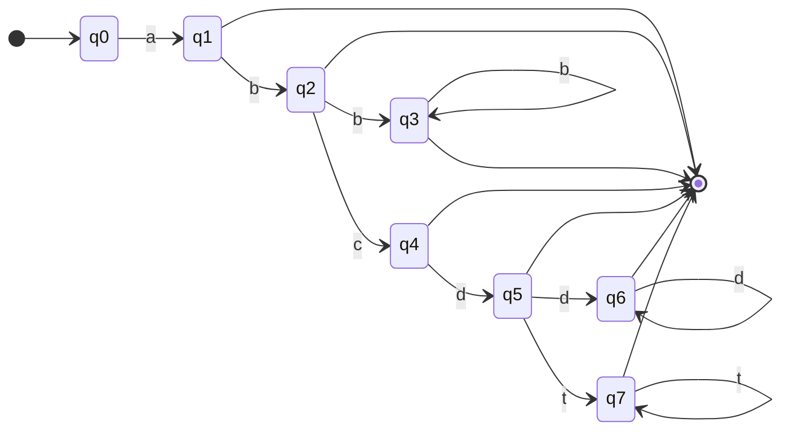
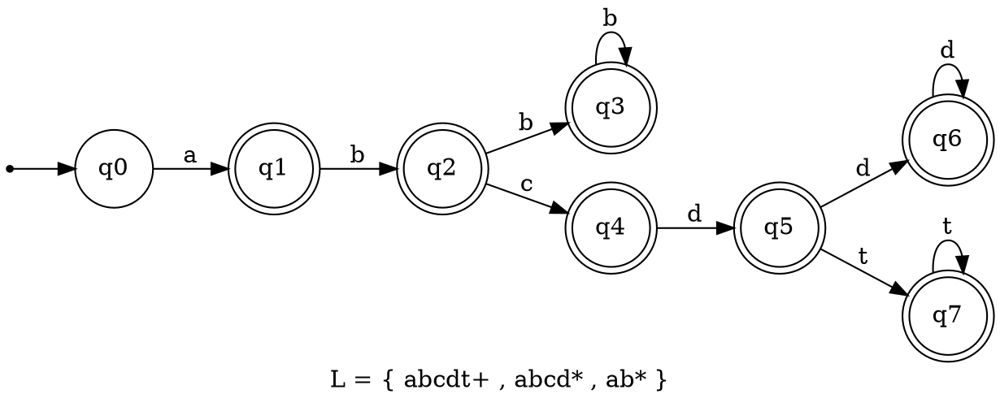

# Autómata de la bomba · Grupo 04

> Archivo generado por la aplicación a partir de config/integrantes.csv. No lo edite a mano.

| Integrante | Cédula | Último dígito | Coordenada |
|---|---|---|---|
| Sebastián Jibaja | 1754265385 | 5 | Coord-05 |
| Karen Mosquera | 1750094144 | 4 | Coord-04 |
| Kened Lugmaña | 1727445866 | 6 | Coord-06 |
| David Jumbo | 1725474447 | 7 | Coord-07 |
| Daniel Mera | 1850629039 | 9 | Coord-09 |
| Leonel Morales | 1752137297 | 7 | Coord-07 |

Coordenadas objetivo: Coord-05, Coord-04, Coord-06, Coord-07, Coord-09

**L = { abcdt+ , abcd* , ab* }**

## Definición formal

```
A = (Q, Σ, δ, q0, F)
Q  = {q0, q1, q2, q3, q4, q5, q6, q7}
Σ  = {a, b, c, d, t}
q0 = q0
F  = {q1, q2, q3, q4, q5, q6, q7}
δ:
   δ(q0, a) = q1
   δ(q1, b) = q2
   δ(q2, b) = q3
   δ(q2, c) = q4
   δ(q3, b) = q3
   δ(q4, d) = q5
   δ(q5, d) = q6
   δ(q5, t) = q7
   δ(q6, d) = q6
   δ(q7, t) = q7
```

## Gramática

```
G = (N, T, P, S)
N = {S, A, B, C, D, E, F, G}
T = {a, b, c, d, t}
S = S
P:
   S → aA | a
   A → bB | b
   B → bC | b | cD | c
   C → bC | b
   D → dE | d
   E → dF | d | tG | t
   F → dF | d
   G → tG | t
```

## Grafo



Graphviz (pegar en https://dreampuf.github.io/GraphvizOnline):


