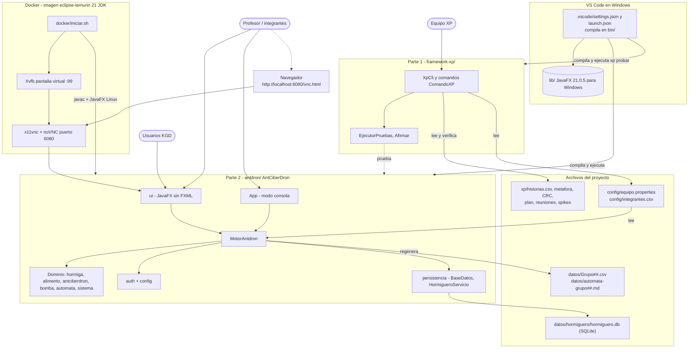
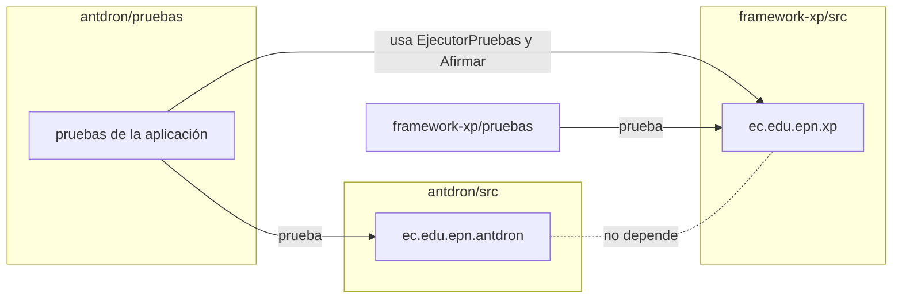

# Arquitectura

**Responsable:** Integrante 5 (Consultor) · **Historias:** XP-04 (diseño) y HU-13 (aplicación dockerizada).

El proyecto son **dos partes independientes** que se abren juntas en **VS Code** (Windows) y una imagen Docker. No se usa Maven ni herramienta de construcción: VS Code compila las cuatro carpetas de fuentes en `bin/` con los `.jar` de JavaFX 21.0.5 para Windows que trae `lib/`, y Docker compila lo mismo con `javac` y JavaFX para Linux.

## Vista general

## Independencia entre las dos partes

La aplicación se compila **sin** el framework (`javac` solo con JavaFX). Solo las pruebas de la aplicación, que están en otra carpeta, usan el ejecutor de pruebas y `Afirmar` del framework. Así, borrar `framework-xp/` no rompe la aplicación.

## Capas

| Capa | Paquetes | Responsabilidad |
|---|---|---|
| Presentación | `ec.edu.epn.antdron.ui`, `App` (consola) | Pestañas JavaFX (Equipo, Coordenadas, Bomba y autómata, AntCiberDron, Hormiguero virtual) y modo consola. Solo muestran lo que entrega el motor. |
| Orquestación | `MotorAntdron` | Lee `config/`, regenera `Grupo##.csv`, la bomba y `automata-grupo##.md`, y crea el AntCiberDron. |
| Dominio | `hormiga`, `alimento`, `antciberdron`, `bomba`, `automata`, `sistema`, `pkAntCiberDronContract` | Reglas del enunciado: hormigas y alimentos, IA y armas, autómata, estrategia OTAN, coordenadas. |
| Configuración y seguridad | `config`, `auth` | Lectura de `config/`, validación de usuarios (3 intentos) y claves con SHA-256. |
| Persistencia | `persistencia` | Base SQLite `datos/hormiguero/hormiguero.db` con cuatro tablas (ver `modelo-er.md`). |
| Proceso XP | `framework-xp` | Comandos `xp ...` que dictan y verifican las prácticas XP. |

## Decisiones de arquitectura

| Decisión | Motivo | Consecuencia |
|---|---|---|
| JavaFX **sin FXML** | Las pantallas son código Java (`Ui` y los paneles). Menos archivos y nada que cargar en tiempo de ejecución. | Las vistas se prueban igual que cualquier clase; no hay editor visual. |
| **Sin Maven ni herramienta de construcción** | Se trabaja en Windows con VS Code; nada que instalar aparte del JDK y la extensión de Java. | `.vscode/settings.json` define las carpetas de fuentes y `lib/` trae JavaFX; ver `xp/spikes.md`. |
| Persistencia en **SQLite** | Base de datos real en un solo archivo, sin servidor; el controlador es un único `.jar` en `lib/`. | Claves foráneas, valores permitidos y transacciones los garantiza la base; para ver los datos se usa una herramienta como DB Browser for SQLite. |
| **Ejecutor de pruebas propio** | Sin Maven no hay JUnit; además permite el reporte de aceptación por historia con `@Historia`. | Solo existen las funciones necesarias de `Afirmar` y de las anotaciones `@Prueba`, `@AntesDeCada` y `@DespuesDeCada`. |
| **Independencia verificada** | La aplicación sigue las directrices XP pero no importa el framework. | `IndependenciaTest` falla si `antdron/src` importa el framework, y Docker compila la aplicación sola. |
| **Configuración por archivo** | El equipo solo escribe cédulas en `config/integrantes.csv`. | Al recargar, el motor regenera coordenadas, bomba y autómata sin tocar código. |
| **Docker con Xvfb + noVNC** | Probar la interfaz sin instalar Java ni tener pantalla. | `docker compose up --build` y abrir `http://localhost:6080/vnc.html`; `config/` y `datos/` se montan como volúmenes. |
| **Integración continua local** | Cada pareja integra varias veces al día sin depender de servicios externos. | «Pruebas + reporte de aceptación» en VS Code antes de subir; `docker compose build` vuelve a ejecutar todas las pruebas. |

## Cómo se ejecuta

| Qué | Cómo |
|---|---|
| Aplicación JavaFX | VS Code: «AntCiberDron (JavaFX)» y F5 |
| Consola | VS Code: «AntCiberDron (consola)» |
| Pruebas y reporte de aceptación | «Pruebas + reporte de aceptación» en VS Code |
| Framework XP | VS Code: «Framework XP (comando)» → `ayuda`, `verificar`, ... |
| Docker (interfaz en el navegador) | `docker compose up --build` y abrir `http://localhost:6080/vnc.html` |
| Docker (consola) | `docker compose run --rm consola` |
