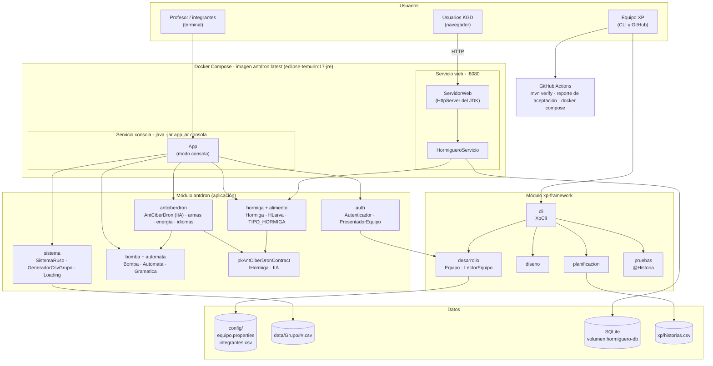

# Diagrama de arquitectura

**Responsable:** Integrante 5 (Consultor).

Aplicación Java 17 en dos módulos Maven. Una sola imagen Docker ofrece dos modos: **consola** (requerimientos de la KGD) y **web** (hormiguero virtual).

## Capas y decisiones

| Capa | Paquetes | Decisión |
|---|---|---|
| Presentación | `App` (consola), `web` (HTML generado en el servidor) | Sin frameworks web: el `HttpServer` del JDK basta para pocas pantallas (funcionalidad mínima). |
| Dominio | `hormiga`, `alimento`, `antciberdron`, `bomba`, `automata`, `sistema` | Reglas puras y probadas con JUnit; no dependen de la consola ni de la base de datos. |
| Contratos | `pkAntCiberDronContract` | Interfaces del enunciado (`IHormiga`, `IIA`). |
| Persistencia | `persistencia` | SQLite embebido (un archivo): no requiere otro contenedor. |
| Proceso XP | `xp-framework` | Independiente de la aplicación; la aplicación lo usa para el equipo y las pruebas de aceptación. |
| Despliegue | `Dockerfile` multi-etapa, `docker-compose.yml` | La etapa de build ejecuta todas las pruebas; la imagen final solo lleva el JRE y el jar, con un usuario sin privilegios. |
