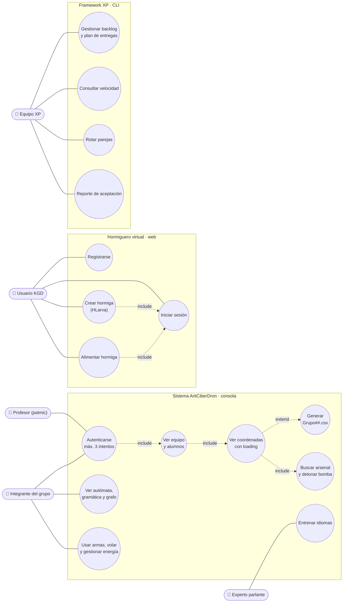
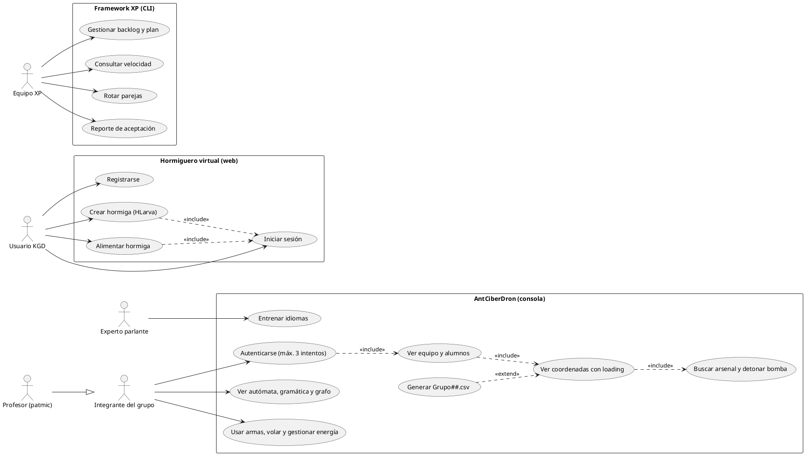

# Diagrama de casos de uso

**Responsable:** Integrante 2 (Cliente).

Actores: **Integrante del grupo**, **Profesor** (patmic), **Usuario KGD** (pantallas web), **Experto parlante** y **Equipo XP** (framework).

## Versión UML (PlantUML)

Pegue este código en https://www.plantuml.com/plantuml para obtener el diagrama UML estándar:

