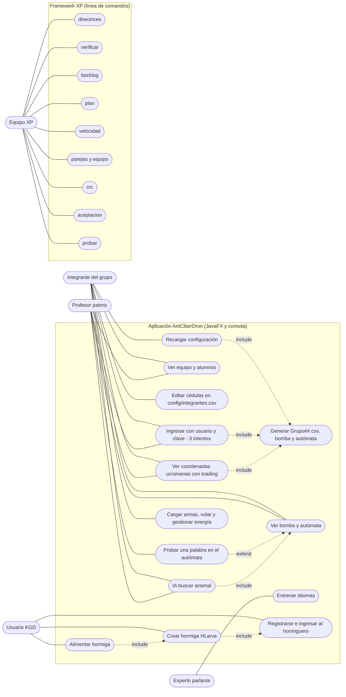
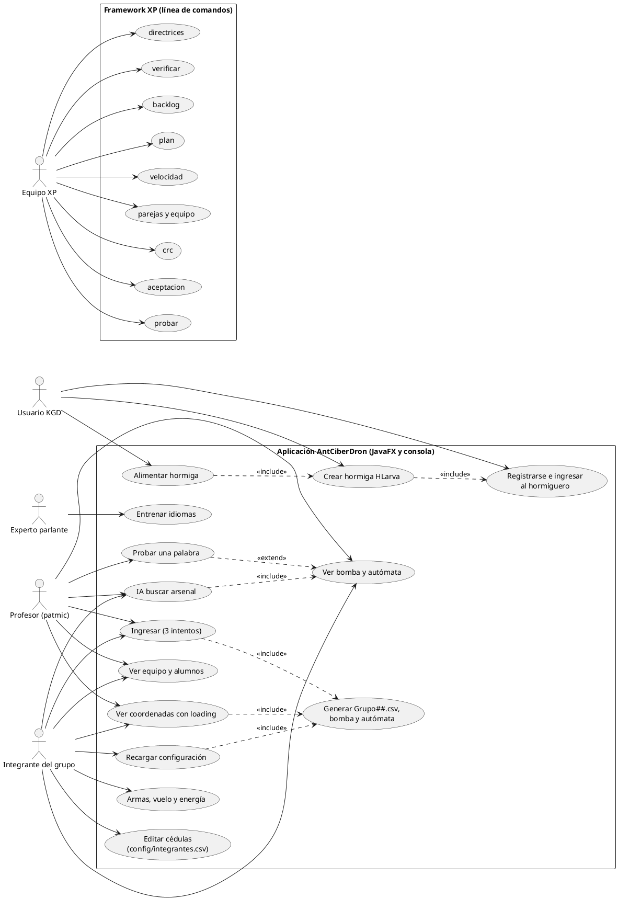

# Diagrama de casos de uso

**Responsable:** Integrante 2 (Cliente) · **Historias:** XP-02, HU-01, HU-02 y HU-09.

## Actores

| Actor | Quién es | Qué hace |
|---|---|---|
| **Integrante del grupo** | Alumno del equipo (usuario de `config/integrantes.csv`) | Ingresa, edita sus cédulas, recarga la configuración y usa todas las pestañas de la aplicación. |
| **Profesor (patmic)** | Usuario `patmic` / clave `123` | Ingresa por consola, JavaFX o Docker para revisar el equipo, las coordenadas, la bomba y el autómata. |
| **Usuario KGD** | Jugador del hormiguero virtual (se registra solo) | Se registra, ingresa, crea `HLarva` y las alimenta. |
| **Experto parlante** | Persona que domina un idioma (`ExpertoParlante`) | Entrena léxico, gramática y fonética del AntCiberDron; solo puede entrenar su idioma nativo. |
| **Equipo XP** | Los seis integrantes en sus roles XP | Usa el framework desde la línea de comandos (`antdron.cmd xp ...`). |

## 1. Aplicación AntCiberDron y framework XP (Mermaid)

## 2. Descripción de los casos de uso

| Caso de uso | Actor | Descripción breve | Historia |
|---|---|---|---|
| Ingresar con usuario y clave | Integrante, Profesor | Pide usuario y contraseña; después de **3 intentos** fallidos se bloquea. Los usuarios salen de `config/integrantes.csv` (más `patmic`/`123`). | HU-01 |
| Ver equipo y alumnos | Integrante, Profesor | Muestra `[+] TEAM [N]: nombre` y cada alumno con cédula y nombre (la cédula vacía se muestra como pendiente). | HU-02 |
| Editar cédulas | Integrante | El equipo escribe las cédulas en `config/integrantes.csv`; pueden quedar vacías con un aviso. | HU-15 |
| Recargar configuración | Integrante | El botón «Recargar configuración» vuelve a leer `config/` y regenera todo (o se reinicia la aplicación). | HU-15 |
| Generar `Grupo##.csv`, bomba y autómata | Sistema | Una coordenada por último dígito, con el horario de la estrategia OTAN y una palabra `w` del lenguaje; la bomba y `datos/automata-grupo##.md` se regeneran. | HU-03, HU-06, HU-14 |
| Ver coordenadas con loading | Integrante, Profesor | Lee `Grupo##.csv` con un loading giratorio hasta 100 % por línea y muestra la tabla Loading, Geoposición, días y Tipo Arsenal. | HU-04 |
| Ver bomba y autómata | Integrante, Profesor | Pestaña «Bomba y autómata»: lenguaje, coordenadas objetivo, definición formal, gramática y grafo dibujado. | HU-06, HU-14 |
| Probar una palabra | Profesor | Escribe una palabra `w` y pulsa «¿w ∈ L?»: la bomba explota solo si la coordenada es objetivo **y** el autómata acepta el arsenal. | HU-14 |
| IA buscar arsenal | Integrante, Profesor | `AntCiberDron.buscar(tipoArsenal)` devuelve `true` o `false` y presenta Geoposición, Tipo Arsenal y Acción. | HU-07 |
| Armas, vuelo y energía | Integrante | Metralleta en la pata delantera derecha, láser en la izquierda con potencia según la energía; el turbo reactor de la espalda consume energía; la IIA recarga o reemplaza la fuente. | HU-08, HU-09 |
| Entrenar idiomas | Experto parlante | Entrena léxico, gramática y fonética; un no experto recibe `EntrenamientoNoAutorizadoException`. | HU-10 |
| Registrarse e ingresar al hormiguero | Usuario KGD | Crea un usuario (clave con sal y hash) y su hormiguero; luego ingresa. | HU-11, HU-12 |
| Crear hormiga | Usuario KGD | Toda hormiga nace como `HLarva` según el `TIPO_HORMIGA` del grupo. | HU-05, HU-11 |
| Alimentar hormiga | Usuario KGD | La larva vive con néctar y se transforma con su alimento; los adultos viven solo con el suyo; queda en el historial. | HU-05, HU-11 |
| Comandos del framework | Equipo XP | `directrices`, `verificar`, `backlog`, `plan`, `velocidad`, `equipo`, `parejas`, `crc`, `aceptacion` y `probar`. | XP-01 a XP-06 |

## 3. Versión PlantUML

Para generar la imagen, pegue el código en <https://www.plantuml.com/plantuml> o use `plantuml casos-uso.puml`.

