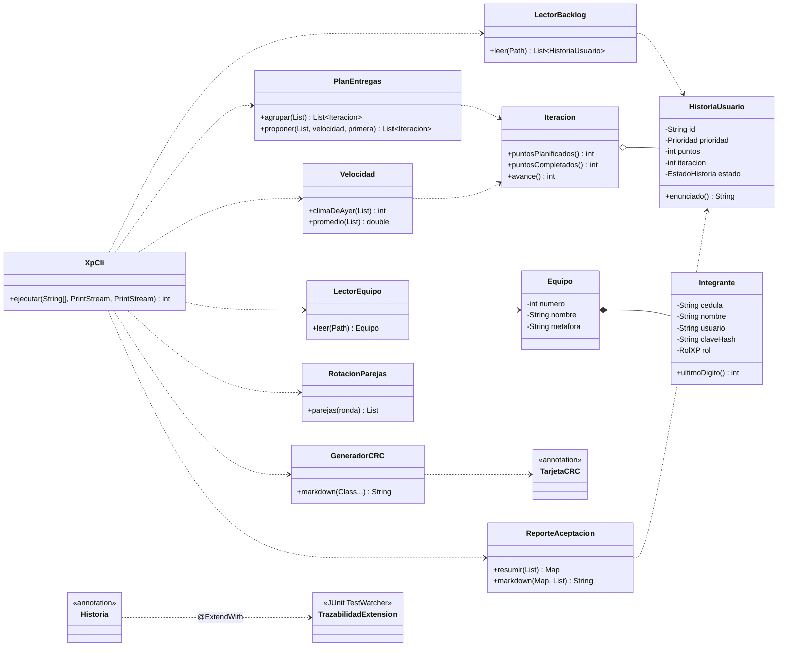

# Diagrama de clases

**Responsable:** Integrante 4 (Encargado de seguimiento). Sigue el diagrama de referencia del enunciado: `Hormiga` y `Alimento` abstractos, el paquete `pkAntCiberDronContract` con `IHormiga` e `IIA`, y `SistemaRuso.readCoord(fileName): List<CoordenadaUK>`.

## Aplicación AntCiberDron

```mermaid
classDiagram
    direction TB

    namespace pkAntCiberDronContract {
        class IHormiga {
            <<interface>>
            +comer(Alimento) boolean
        }
        class IIA {
            <<interface>>
            +buscar(tipoArsenal String) boolean
        }
    }

    class Hormiga {
        <<abstract>>
        -Integer id
        -String sexo
        -String estado
        -List~Extremidad~ extremidades
        +Hormiga()
        +getTipo() String
        +getAlimentoVital() Alimento
        +comer(Alimento) boolean
        +toString() String
    }
    class HLarva {
        -TipoHormiga destino
        -Hormiga evolucion
        +HLarva(TipoHormiga)
        +comer(Alimento) boolean
        +getEvolucion() Optional~Hormiga~
    }
    class HSoldado {
        +HSoldado()
    }
    class HZangano {
        +HZangano()
    }
    class HRastreadora {
        +HRastreadora()
    }
    class TipoHormiga {
        <<enumeration>>
        SOLDADO
        ZANGANO
        RASTREADORA
        +paraGrupo(int) TipoHormiga
        +alimento() Alimento
        +crear(id, sexo) Hormiga
    }
    class Extremidad {
        <<enumeration>>
        PATA_DELANTERA_DERECHA
        PATA_DELANTERA_IZQUIERDA
        ...
    }

    class Alimento {
        <<abstract>>
        +Alimento()
        +toString() String
    }
    class ANectar
    class ACarnivoro
    class AOmnivoro
    class AHerbivoro

    class AntCiberDron {
        -Hormiga piloto
        -Map cargas
        -FuentePoder fuente
        +buscar(tipoArsenal) boolean
        +buscarObjetivos() List~CoordenadaUK~
        +equiparMetralleta(Metralleta)
        +equiparLaser(Laser)
        +volar(minutos) String
        +recargarFuente() String
        +reemplazarFuente(FuentePoder) String
        +aprender(ExpertoParlante, Idioma, AspectoLinguistico, String)
    }
    class Arma {
        <<interface>>
        +disparar(FuentePoder) String
    }
    class Metralleta {
        -int municion
    }
    class Laser {
        -double potenciaMaxima
        +potencia(FuentePoder) double
    }
    class TurboReactor {
        +UBICACION = "espalda"
        +volar(min, FuentePoder) String
    }
    class FuentePoder {
        -double capacidad
        -double energia
        +consumir(double)
        ~recargar()
        +porcentaje() double
    }
    class ModuloIdiomas {
        +entrenar(ExpertoParlante, Idioma, AspectoLinguistico, String)
        +dominio(Idioma) int
    }
    class ExpertoParlante {
        -String nombre
        -Idioma idiomaNativo
    }

    class Bomba {
        -Set~Integer~ digitosObjetivo
        +paraEquipo(Equipo) Bomba
        +evaluar(tipoArsenal) boolean
        +debeExplotar(CoordenadaUK) boolean
    }
    class Automata {
        -int numeroEstados
        -Set~Character~ alfabeto
        -Map delta
        -int inicial
        -Set~Integer~ finales
        +acepta(String) boolean
        +gramatica() Gramatica
    }
    class ConstructorAutomata {
        +union(List~String~) Automata
    }
    class Gramatica
    class SistemaRuso {
        +readCoord(fileName String) List~CoordenadaUK~
    }
    class CoordenadaUK {
        -String geoposicion
        -Map horarios
        -String tipoArsenal
    }
    class EstrategiaOTAN {
        +expresion(digito) String
    }
    class GeneradorCsvGrupo {
        +escribir(Equipo, Path) Path
    }
    class Autenticador {
        +MAX_INTENTOS = 3
        +autenticar(EntradaUsuario, PrintStream) Optional
    }
    class HormigueroServicio {
        +registrar()
        +crearHormiga()
        +alimentar()
    }
    class ServidorWeb

    IHormiga <|.. Hormiga
    Hormiga <|-- HLarva
    Hormiga <|-- HSoldado
    Hormiga <|-- HZangano
    Hormiga <|-- HRastreadora
    Hormiga *-- Extremidad
    HLarva --> TipoHormiga : destino
    Alimento <|-- ANectar
    Alimento <|-- ACarnivoro
    Alimento <|-- AOmnivoro
    Alimento <|-- AHerbivoro
    Hormiga ..> Alimento : come

    IIA <|.. AntCiberDron
    AntCiberDron o-- Hormiga : piloto
    AntCiberDron *-- Extremidad
    AntCiberDron o-- Arma
    Arma <|.. Metralleta
    Arma <|.. Laser
    AntCiberDron *-- TurboReactor
    AntCiberDron o-- FuentePoder
    AntCiberDron *-- ModuloIdiomas
    ModuloIdiomas ..> ExpertoParlante
    AntCiberDron --> Bomba
    AntCiberDron --> "*" CoordenadaUK
    Bomba --> Automata
    Bomba ..> ConstructorAutomata
    Bomba ..> EstrategiaOTAN
    Automata ..> Gramatica
    SistemaRuso ..> CoordenadaUK
    GeneradorCsvGrupo ..> EstrategiaOTAN
    ServidorWeb --> HormigueroServicio
    HormigueroServicio ..> HLarva
```

## Framework XP

