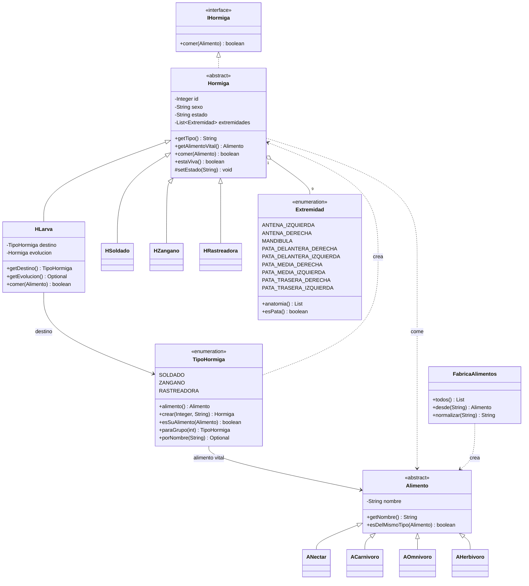
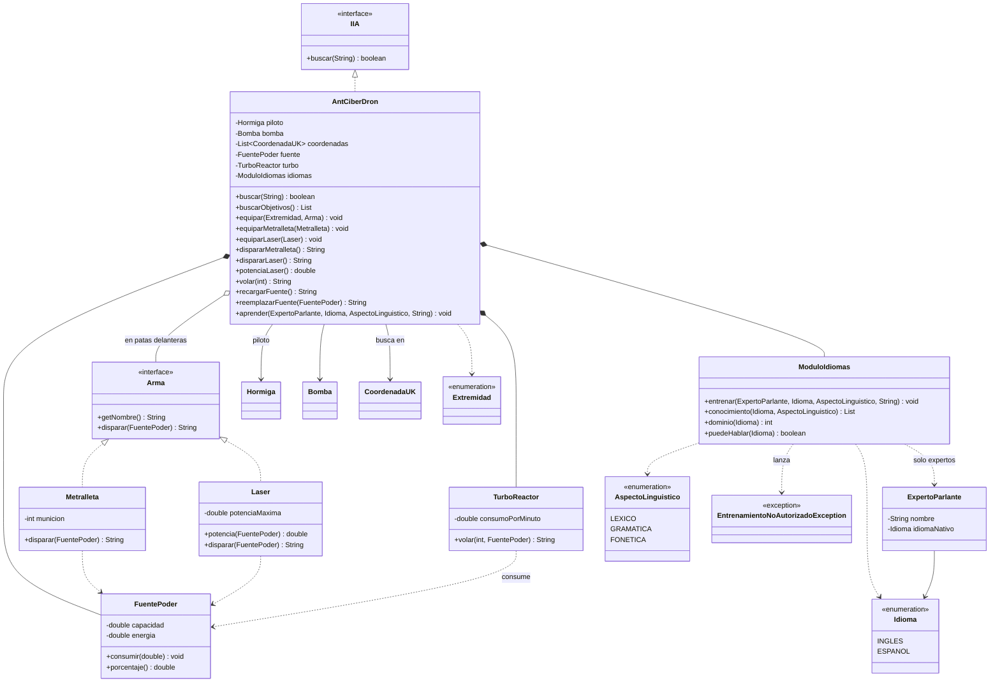
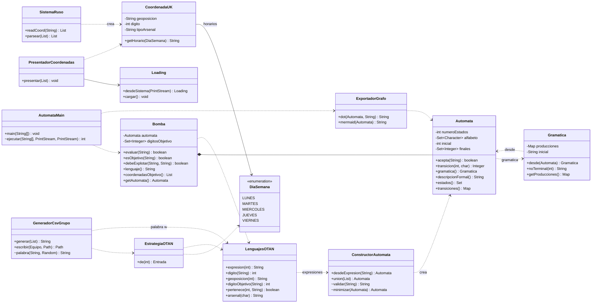
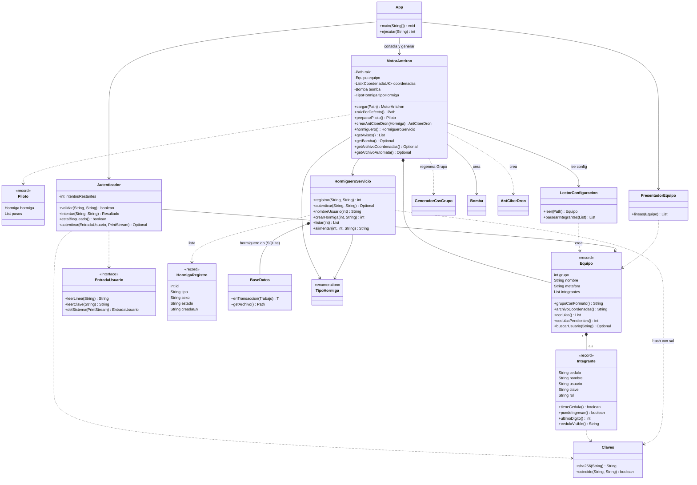
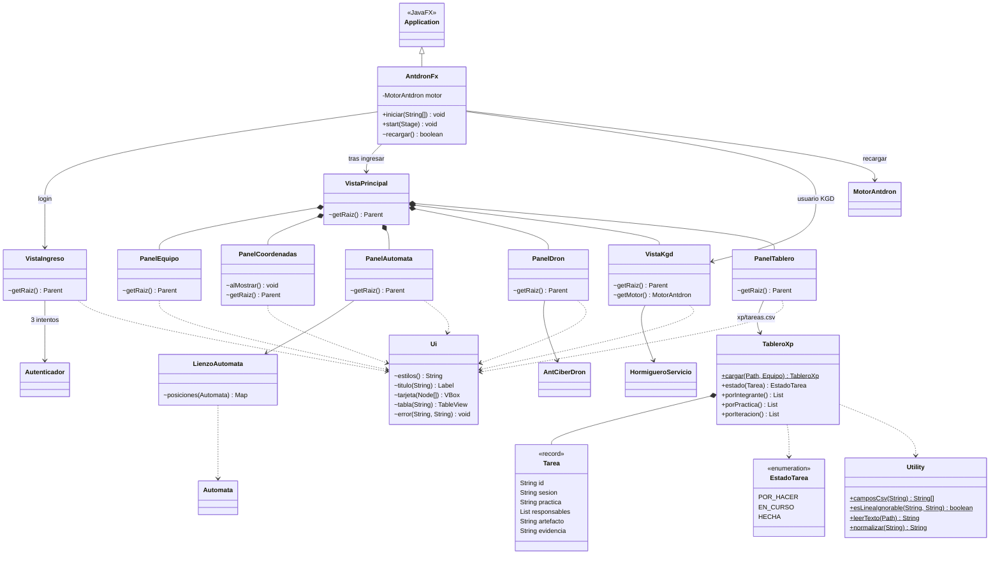
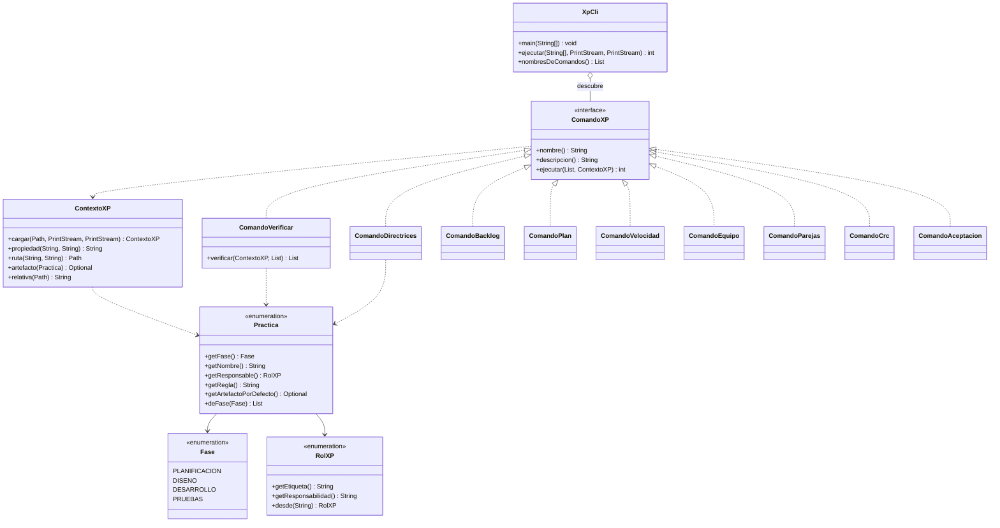
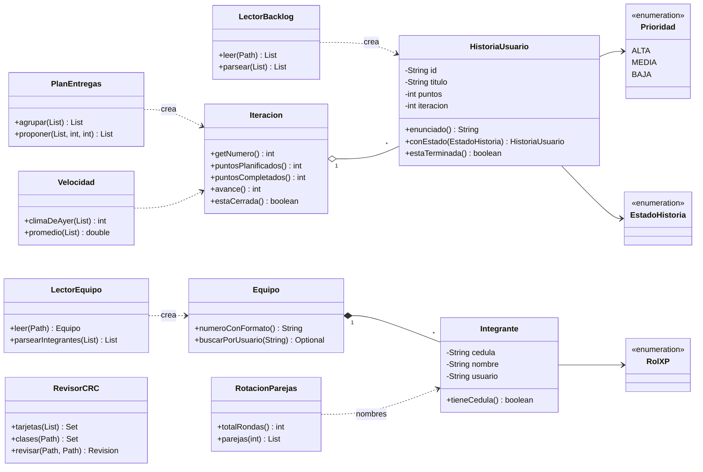
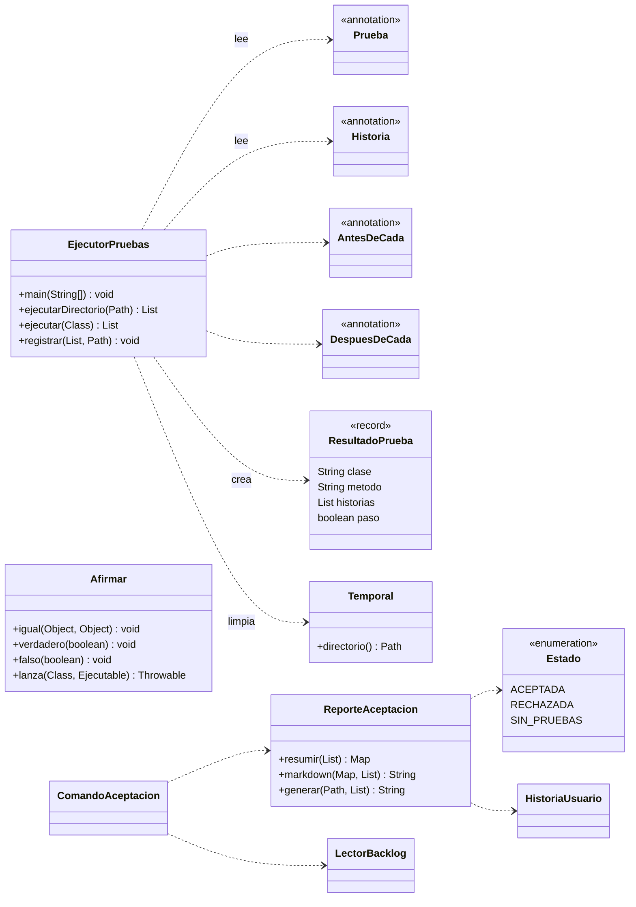

# Diagrama de clases

**Responsable:** David Jumbo (Encargado de seguimiento) · **Historias:** HU-05 (hormigas y alimentos) y HU-10 (idiomas).

El código tiene **dos partes independientes**: la aplicación `antdron/` (JavaFX) y el framework `framework-xp/`. La aplicación no importa ninguna clase del framework. Los diagramas están divididos por tema para que se lean bien; las relaciones entre diagramas se indican en el texto.

Convenciones: `<<abstract>>` clase abstracta, `<<interface>>` interfaz, `<<enumeration>>` enum, `<<record>>` registro de Java.

## 1. Aplicación · Hormigas y alimentos (HU-05)

`Hormiga` y `Alimento` son abstractas y el contrato `pkAntCiberDronContract` define `IHormiga` e `IIA`, como pide el enunciado. Toda hormiga **nace como `HLarva`**: vive con néctar y se transforma al comer el alimento de su `TipoHormiga` (según el número de grupo: 1-2 `HSoldado`, 3-4 `HZangano`, 5 `HRastreadora`).

## 2. Aplicación · AntCiberDron (HU-07 a HU-10)

El `AntCiberDron` lo pilota una hormiga adulta, implementa `IIA` (`buscar`), lleva armas en las patas delanteras (metralleta a la derecha, láser a la izquierda), vuela con el turbo reactor de la espalda y entrena idiomas con la ayuda de un `ExpertoParlante`.

## 3. Aplicación · Autómata, bomba y coordenadas (HU-03, HU-04, HU-06, HU-14)

`LenguajesOTAN` asocia el último dígito de la cédula con una coordenada y un lenguaje regular. `ConstructorAutomata` construye el AFD mínimo de la unión; `Bomba` lo usa para explotar solo en coordenadas objetivo con arsenal aceptado. `SistemaRuso.readCoord(fileName)` lee `Grupo##.csv` y devuelve `List<CoordenadaUK>`.

## 4. Aplicación · Configuración, autenticación y persistencia (HU-01, HU-02, HU-12, HU-15)

`MotorAntdron` es el punto central: lee `config/`, regenera `datos/Grupo##.csv`, la bomba y `datos/automata-grupo##.md` cada vez que se carga (arranque o «Recargar configuración»), y entrega todo a la consola y a la interfaz JavaFX.

## 5. Aplicación · Interfaz JavaFX (sin FXML) y tablero XP

Las clases de la interfaz son de acceso de paquete (`ec.edu.epn.antdron.ui`) salvo `AntdronFx`. Cada pestaña de `VistaPrincipal` es un panel que recibe el `MotorAntdron`.

`Utility` (paquete `pkAntCiberDronContract`) es el resultado del **reciclaje**: reúne el manejo de líneas CSV con `;`, la lectura de archivos editados en Windows y la normalización de textos que antes estaban repetidos. La usan `LectorConfiguracion`, `SistemaRuso`, `FabricaAlimentos`, `HormigueroServicio` (importación de los CSV anteriores) y `TableroXp`.

## 6. Framework XP (`framework-xp/`)

El núcleo (`XpCli`) ejecuta cualquier `ComandoXP`; cada módulo aporta sus comandos (`directrices`, `verificar`, `backlog`, `plan`, `velocidad`, `equipo`, `parejas`, `crc`, `aceptacion`). El ejecutor de pruebas propio (`EjecutorPruebas`) reemplaza a JUnit y alimenta el reporte de aceptación por historia.

### 6.1 Planificación, seguimiento, desarrollo y diseño

### 6.2 Pruebas y aceptación (XP-05)

