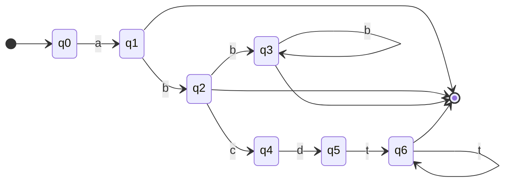
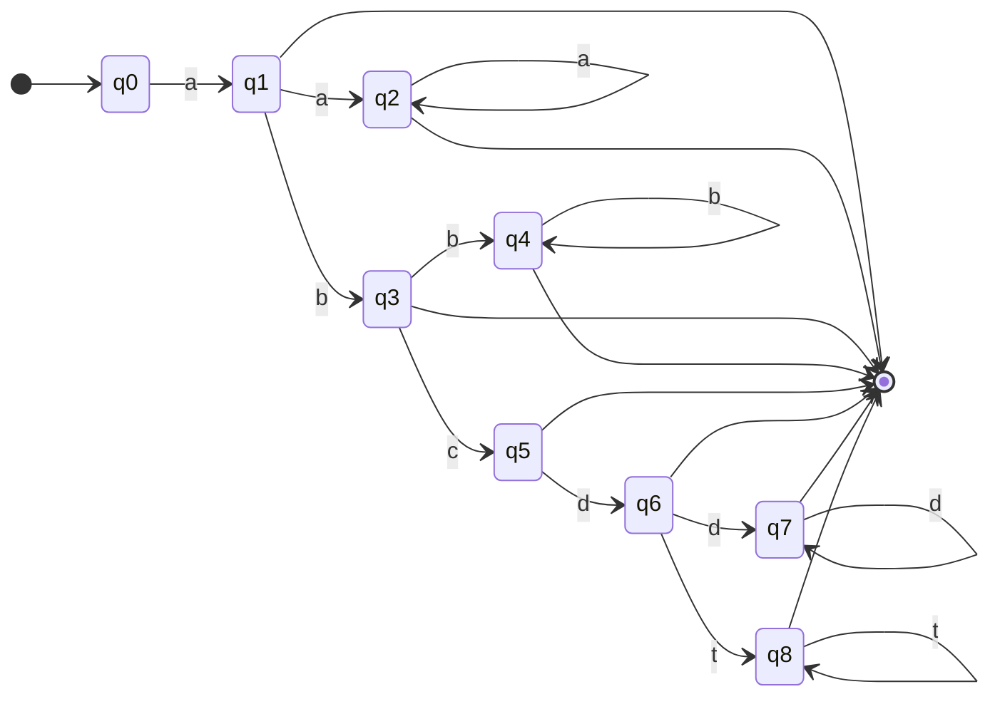

# Grafo y gramática del autómata de la bomba

**Responsable:** Sebastián Jibaja (Entrenador) · **Historias:** HU-06 (autómata) y HU-14 (bomba) · **Código:** `antdron/src/ec/edu/epn/antdron/automata` y `bomba`

## 1. Regla del enunciado

Se toma el **último dígito de la cédula** de cada integrante. Cada dígito es una coordenada de la estrategia OTAN y cada coordenada tiene un lenguaje (tipo de arsenal):

| Coordenada | Horario | Lenguaje | Coordenada | Horario | Lenguaje |
|---|---|---|---|---|---|
| Coord-00 | — | `a+` | Coord-05 | Viernes 05-10 | `abcdt+` |
| Coord-01 | Lunes 01-02 | `a+` | Coord-06 | Jueves 04-08 | `abcdt+` |
| Coord-02 | Martes 02-04 | `ab*` | Coord-07 | Miércoles 03-06 | `abcd*` |
| Coord-03 | Miércoles 03-06 | `abc` | Coord-08 | Martes 02-04 | `abc` |
| Coord-04 | Jueves 04-08 | `abcd*` | Coord-09 | Lunes 01-02 | `ab*` |

Símbolos: **a** = Avión, **b** = Barco, **c** = Convoy, **d** = Dron, **t** = Tanque.

El autómata de la bomba reconoce la **unión** de los lenguajes de las coordenadas objetivo. La bomba explota solo si la coordenada es objetivo **y** el autómata acepta su tipo de arsenal; así se garantiza la destrucción exclusiva.

## 2. Construcción

1. Cada expresión (`x`, `x*`, `x+` concatenados) se traduce a un AFN-ε.
2. Se unen los AFN con un estado inicial nuevo y transiciones ε.
3. Construcción de subconjuntos → AFD.
4. Minimización de Moore y eliminación del estado sumidero → **AFD mínimo** con estados `q0..qn` en orden BFS.
5. Gramática regular lineal por la derecha: por cada δ(qi, x) = qj se agrega `Qi → x Qj` y, si qj es final, `Qi → x`.

La prueba `AutomataTest` compara cada uno de los 10 autómatas, y la unión, contra la expresión regular equivalente en **todas** las palabras de {a,b,c,d,t} de longitud 0 a 7 (97 656 palabras).

## 3. Ejemplo del enunciado: cédulas 110363**5** y 150363**9**

L = { abcdt+ , ab* } → objetivos Coord-05 y Coord-09.

**A = (Q, Σ, δ, q0, F)**

- Q = {q0, q1, q2, q3, q4, q5, q6}
- Σ = {a, b, c, d, t}
- q0 = q0
- F = {q1, q2, q3, q6}

| δ | a | b | c | d | t |
|---|---|---|---|---|---|
| →q0 | q1 | – | – | – | – |
| *q1 | – | q2 | – | – | – |
| *q2 | – | q3 | q4 | – | – |
| *q3 | – | q3 | – | – | – |
| q4 | – | – | – | q5 | – |
| q5 | – | – | – | – | q6 |
| *q6 | – | – | – | – | q6 |

(→ inicial, * final, – rechazo)



**Gramática G = (N, T, P, S)**

```
N = {S, A, B, C, D, E, F}
T = {a, b, c, d, t}
P:
   S → aA | a
   A → bB | b
   B → bC | b | cD
   C → bC | b
   D → dE
   E → tF | t
   F → tF | t
```

Resultado de la búsqueda con el archivo del enunciado:

| Geoposición | Tipo Arsenal | Acción |
|---|---|---|
| Coord-05 | abcdttt | true |
| Coord-09 | ab | true |

`Coord-01 | a` **no** explota: `a ∈ ab*`, pero Coord-01 no es objetivo.

## 4. Ejemplo con seis coordenadas (dígitos 9, 3, 2, 6, 4, 0)

Un equipo de 6 con esos últimos dígitos obtiene la unión de cinco lenguajes distintos:
L = { ab* , abc , abcdt+ , abcd* , a+ }



```
S → aA | a
A → aB | a | bC | b
B → aB | a
C → bD | b | cE | c
D → bD | b
E → dF | d
F → dG | d | tH | t
G → dG | d
H → tH | t
```

## 5. Autómata del equipo

Las cédulas de los integrantes **no se escriben en este documento**: se escriben en `config/integrantes.csv` (primera columna) y la aplicación hace el resto.

| Paso | Qué ocurre |
|---|---|
| 1 | Cada integrante escribe su cédula en `config/integrantes.csv` (columna `cedula`). Pueden faltar algunas: la aplicación avisa y trabaja con las que haya. |
| 2 | Se pulsa **«Recargar configuración»** en la aplicación (o se vuelve a ejecutar desde VS Code; en Docker, el botón de la ventana). |
| 3 | `MotorAntdron` toma el último dígito de cada cédula, obtiene las coordenadas objetivo y el lenguaje de cada una, construye el AFD mínimo de la unión y crea la bomba. |
| 4 | Se regenera **`datos/automata-grupo##.md`** (## = número de grupo con dos dígitos, por ejemplo `datos/automata-grupo01.md`) con la tabla de integrantes, el lenguaje L, la definición formal, la gramática, el grafo Mermaid y el DOT de Graphviz. También se regenera `datos/Grupo##.csv`. |
| 5 | La pestaña **«Bomba y autómata»** muestra lo mismo: lenguaje, coordenadas objetivo, definición formal, gramática, el grafo dibujado y una prueba de palabras (`¿w ∈ L?`). |

Ejemplo de `config/integrantes.csv` (se usan las cédulas del enunciado solo como ejemplo):

```text
cedula;nombre;usuario;clave;rol
1103635;Sebastián Jibaja;sjibaja;1234;ENTRENADOR
1503639;Karen Mosquera;kmosquera;1234;CLIENTE
```

Con esas dos cédulas, `datos/automata-grupo##.md` contiene el autómata del ejemplo de la sección 3 (L = { abcdt+ , ab* }).

Si el último dígito de una cédula nueva ya está incluido, el lenguaje no cambia; solo se agrega la fila en la tabla de integrantes. El archivo `datos/automata-grupo##.md` es generado: **no se edita a mano**, se vuelve a crear en cada recarga.

### Imprimir el autómata de cualquier cédula

Sin tocar `config/`, se puede imprimir el autómata de cualquier lista de cédulas (definición formal, gramática, DOT y Mermaid): en VS Code, **Ejecutar y depurar** (Ctrl+Shift+D) → «AntCiberDron (autómata de cédulas)» → F5, y escriba las cédulas separadas por espacios (por defecto `1103635 1503639`).

Para ver el grafo como imagen, pegue el DOT en <https://dreampuf.github.io/GraphvizOnline> o el bloque Mermaid en <https://mermaid.live>.

### Otros comandos relacionados

| Configuración de VS Code | Qué hace |
|---|---|
| «AntCiberDron (JavaFX)» | Abre la aplicación JavaFX (regenera `datos/` al arrancar). |
| «AntCiberDron (consola)» | Versión de consola: login, equipo, coordenadas con loading y bomba. |
| «Pruebas + reporte de aceptación» | Ejecuta todas las pruebas, incluida `AutomataTest`. |
