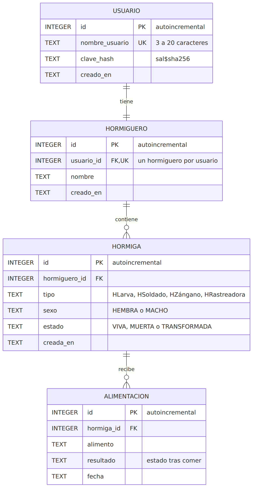
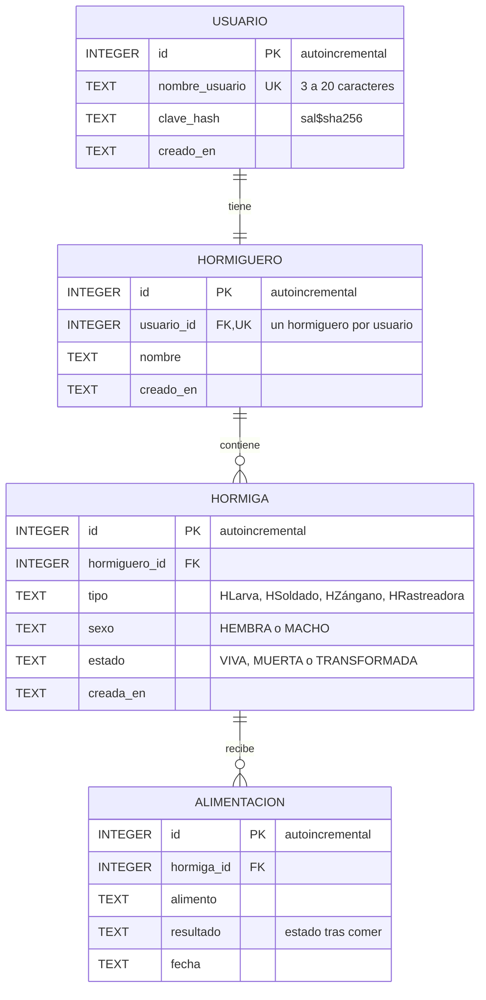

# Modelo entidad-relación

**Responsable:** Leonel Morales (Gestor) · **Historias:** HU-11 (pantallas del hormiguero virtual) y HU-12 (persistencia).

El hormiguero virtual de los usuarios KGD se guarda en una base de datos **SQLite**: el archivo `datos/hormiguero/hormiguero.db`, con **cuatro tablas**. La base se crea sola la primera vez que se abre el hormiguero; el esquema está en `antdron/src/ec/edu/epn/antdron/persistencia/esquema.sql`. `BaseDatos` abre la conexión (controlador `lib/sqlite-jdbc-3.54.1.0.jar`) y `HormigueroServicio` aplica las reglas del dominio.





## Tablas

| Tabla | Columnas | Claves |
|---|---|---|
| `usuario` | `id`, `nombre_usuario`, `clave_hash`, `creado_en` | PK `id`; `nombre_usuario` único |
| `hormiguero` | `id`, `usuario_id`, `nombre`, `creado_en` | PK `id`; FK `usuario_id` → `usuario.id` (único) |
| `hormiga` | `id`, `hormiguero_id`, `tipo`, `sexo`, `estado`, `creada_en` | PK `id`; FK `hormiguero_id` → `hormiguero.id` |
| `alimentacion` | `id`, `hormiga_id`, `alimento`, `resultado`, `fecha` | PK `id`; FK `hormiga_id` → `hormiga.id` |

Las claves foráneas usan `ON DELETE CASCADE` y hay índices en `hormiga.hormiguero_id` y `alimentacion.hormiga_id`.

## Relaciones

- **Usuario 1–1 Hormiguero:** al registrarse se crean el usuario y su hormiguero («Hormiguero de `usuario`») en la misma transacción.
- **Hormiguero 1–N Hormiga:** un hormiguero contiene varias hormigas; cada una nace como `HLarva`.
- **Hormiga 1–N Alimentación:** cada vez que una hormiga come se actualiza su tipo/estado y se agrega una fila al historial, en la misma transacción.

## Reglas y restricciones

| Regla | Dónde se aplica |
|---|---|
| `id` lo asigna SQLite (`INTEGER PRIMARY KEY AUTOINCREMENT`). | `esquema.sql` |
| `nombre_usuario` es único y tiene de 3 a 20 caracteres; la aplicación además exige letras, números o `_`. | `esquema.sql` (`UNIQUE`, `CHECK`), `HormigueroServicio.registrar` |
| La contraseña tiene al menos 4 caracteres y se guarda como `sal$sha256(sal + clave)`, con sal aleatoria de 16 bytes. Nunca se guarda en texto plano. | `HormigueroServicio`, `Claves` |
| Cada hormiga pertenece a un hormiguero que existe; cada alimentación, a una hormiga que existe. | `esquema.sql` (`REFERENCES`, `PRAGMA foreign_keys = ON` en cada conexión) |
| `tipo` es `HLarva` al crear y cambia al tipo adulto (`HSoldado`, `HZángano` o `HRastreadora`) cuando la larva come su alimento. | `esquema.sql` (`CHECK`), `HormigueroServicio.alimentar` |
| `sexo` es `HEMBRA` o `MACHO`. | `esquema.sql` (`CHECK`), `Hormiga` |
| `estado` y `resultado` son `VIVA`, `MUERTA` o `TRANSFORMADA`; una hormiga muerta no puede volver a comer. | `esquema.sql` (`CHECK`), `HormigueroServicio.alimentar` |
| `alimento` es el nombre del alimento ofrecido (Néctar, Carnívoro, Omnívoro o Herbívoro). | `FabricaAlimentos` |
| Un usuario solo ve y alimenta las hormigas de su propio hormiguero. | `HormigueroServicio.listar` (consulta con `JOIN` por `usuario_id`) |
| Fechas con formato `yyyy-MM-dd HH:mm:ss`. | `HormigueroServicio` |

## Ejemplo de contenido

```sql
SELECT h.id, h.tipo, h.sexo, h.estado, u.nombre_usuario
FROM hormiga h
JOIN hormiguero hg ON hg.id = h.hormiguero_id
JOIN usuario u ON u.id = hg.usuario_id;
```

```text
id | tipo     | sexo   | estado | nombre_usuario
1  | HLarva   | HEMBRA | VIVA   | demo_kgd
2  | HSoldado | MACHO  | VIVA   | demo_kgd
```

Para abrir la base se puede usar [DB Browser for SQLite](https://sqlitebrowser.org/) o la extensión «SQLite Viewer» de VS Code.

## Datos de la versión anterior (CSV)

Antes el hormiguero se guardaba en `usuarios.csv`, `hormigueros.csv`, `hormigas.csv` y `alimentaciones.csv`. Si al abrir el hormiguero la base no tiene usuarios y esos archivos existen en `datos/hormiguero/`, se copian una sola vez a SQLite conservando los `id`. Los CSV no se modifican y ya no se usan.

## Decisión: SQLite

Ver el spike 3 en `xp/spikes.md`. SQLite es una base de datos relacional en un solo archivo, sin servidor; el controlador es un único `.jar` que ya incluye SQLite para Windows, Linux y Mac, así que el proyecto sigue sin Maven. `datos/` se monta como volumen en Docker y las pruebas usan carpetas temporales.
