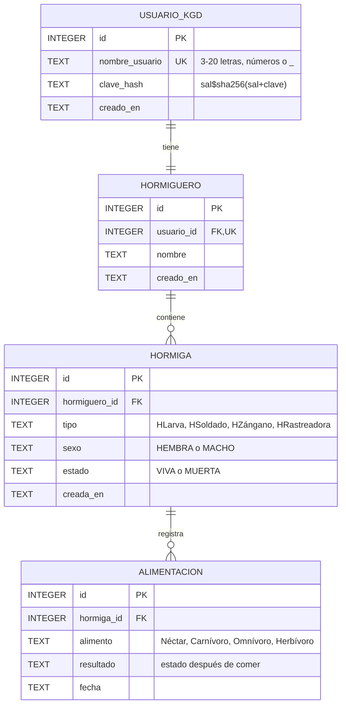

# Modelo entidad-relación

**Responsable:** Integrante 6 (Gestor). Base de datos SQLite del hormiguero virtual (`antdron/.../persistencia/BaseDatos.java`). En Docker se guarda en el volumen `hormiguero-db`.

## Reglas

- Cada usuario KGD tiene exactamente un hormiguero, creado en la misma transacción del registro.
- Toda hormiga nace con `tipo = HLarva` y `estado = VIVA`. Al alimentarla se aplican las reglas del dominio (`Hormiga.comer`): si la larva come el alimento del TIPO_HORMIGA del grupo, `tipo` cambia a ese tipo; si come otra cosa distinta del néctar, `estado` pasa a `MUERTA`.
- Cada alimentación queda registrada en `ALIMENTACION` (historial).
- Un usuario solo puede ver y alimentar las hormigas de su hormiguero (se filtra por `hormiguero_id`).
- Las claves foráneas se activan con `PRAGMA foreign_keys = ON`.
