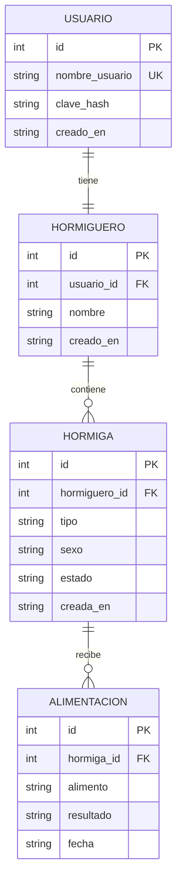

# Modelo entidad-relación

**Responsable:** Integrante 6 (Gestor) · **Historias:** HU-11 (pantallas del hormiguero virtual) y HU-12 (persistencia).

El hormiguero virtual de los usuarios KGD se guarda en **cuatro tablas** que viven como archivos **CSV** (separador `;`, primera línea con la cabecera) en `datos/hormiguero/`. No hay base de datos ni controladores externos: la clase `TablaCsv` lee y escribe cada archivo y `HormigueroServicio` aplica las reglas del dominio. Los archivos se crean solos la primera vez que se usa el hormiguero.



## Tablas y archivos

| Tabla | Archivo | Columnas (en orden) |
|---|---|---|
| `USUARIO` | `datos/hormiguero/usuarios.csv` | `id;nombre_usuario;clave_hash;creado_en` |
| `HORMIGUERO` | `datos/hormiguero/hormigueros.csv` | `id;usuario_id;nombre;creado_en` |
| `HORMIGA` | `datos/hormiguero/hormigas.csv` | `id;hormiguero_id;tipo;sexo;estado;creada_en` |
| `ALIMENTACION` | `datos/hormiguero/alimentaciones.csv` | `id;hormiga_id;alimento;resultado;fecha` |

## Relaciones

- **Usuario 1–1 Hormiguero:** al registrarse se crea el usuario y, en la misma operación, su hormiguero («Hormiguero de `usuario`»).
- **Hormiguero 1–N Hormiga:** un hormiguero contiene varias hormigas; cada una nace como `HLarva`.
- **Hormiga 1–N Alimentación:** cada vez que una hormiga come se agrega una fila al historial.

## Reglas y restricciones

| Regla | Dónde se aplica |
|---|---|
| `id` es numérico y se asigna como el máximo existente + 1 (primera columna de cada archivo). | `TablaCsv.insertar` |
| `nombre_usuario` es único: de 3 a 20 letras, números o `_`. | `HormigueroServicio.registrar` |
| La contraseña tiene al menos 4 caracteres y se guarda como `sal$sha256(sal + clave)`, con sal aleatoria de 16 bytes. Nunca se guarda en texto plano. | `HormigueroServicio`, `Claves` |
| `tipo` es `HLarva` al crear y cambia al tipo adulto (`HSoldado`, `HZángano` o `HRastreadora`) cuando la larva come su alimento. | `HormigueroServicio.alimentar` |
| `sexo` es `HEMBRA` o `MACHO`. | `Hormiga` |
| `estado` es `VIVA`, `MUERTA` o `TRANSFORMADA`; una hormiga muerta no puede volver a comer. | `Hormiga`, `HormigueroServicio.alimentar` |
| `alimento` es el nombre del alimento ofrecido (Néctar, Carnívoro, Omnívoro o Herbívoro); `resultado` es el estado en que quedó la hormiga. | `FabricaAlimentos` |
| Un usuario solo ve y alimenta las hormigas de su propio hormiguero. | `HormigueroServicio.listar` |
| Fechas con formato `yyyy-MM-dd HH:mm:ss`. | `HormigueroServicio` |
| Antes de guardar, `;` se cambia por `,` y los saltos de línea por espacios para no romper el CSV. | `TablaCsv` |

## Ejemplo de contenido

`usuarios.csv`

```text
id;nombre_usuario;clave_hash;creado_en
1;hormigon;3f9a...e1$8c2d...b7;2026-11-16 10:15:02
```

`hormigas.csv`

```text
id;hormiguero_id;tipo;sexo;estado;creada_en
1;1;HSoldado;HEMBRA;TRANSFORMADA;2026-11-16 10:16:40
2;1;HLarva;MACHO;VIVA;2026-11-16 10:17:05
```

## Decisión: CSV en lugar de base de datos

El proyecto se compila sin Maven ni librerías externas, así que no hay un controlador JDBC disponible. Con CSV el equipo puede abrir los datos en cualquier editor o en Excel, los archivos se montan como volumen de Docker (`./datos`) y las pruebas usan carpetas temporales. El modelo sigue siendo el mismo que tendría en una base relacional; ver el spike en `xp/spikes.md`.
